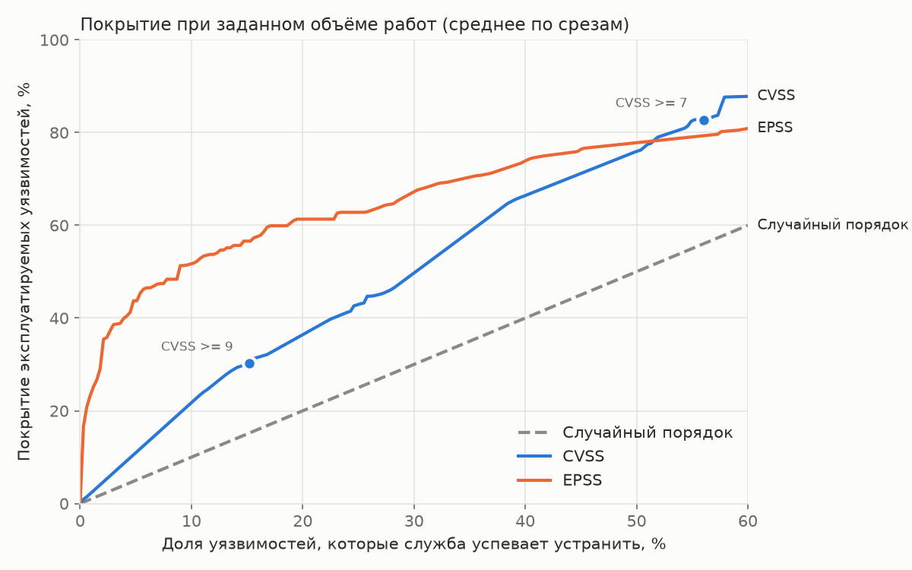

# Базовые линии приоритизации

Сформировано: 2026-10-26 16:29. Версия каталога CISA KEV: 2026.10.23.

Отчёт формируется командой `patchprio baseline`. Методика: [docs/methodology.md](../../docs/methodology.md).

## Срезы

| Срез | Окно публикации | CVE | Эксплуатируемых | Доля | Исключено (уже в KEV) | Без CVSS | EPSS |
|---|---|---|---|---|---|---|---|
| 2022-01-01 | 2021-01-01 .. 2022-01-01 | 19 849 | 50 | 0.3% | 123 | 0.0% | есть |
| 2022-07-01 | 2021-07-01 .. 2022-07-01 | 22 691 | 27 | 0.1% | 129 | 0.0% | v2022.01.01 |
| 2023-01-01 | 2022-01-01 .. 2023-01-01 | 24 685 | 19 | 0.1% | 98 | 0.0% | v2022.01.01 |
| 2023-07-01 | 2022-07-01 .. 2023-07-01 | 26 182 | 17 | 0.1% | 100 | 0.0% | v2023.03.01 |

## Покрытие при фиксированном бюджете

Какая доля реально эксплуатируемых уязвимостей окажется устранена, если служба успевает закрыть указанную долю всех уязвимостей. Среднее по срезам.

| Способ | Бюджет 1% | Бюджет 5% | Бюджет 10% | Бюджет 20% |
|---|---|---|---|---|
| Случайный порядок | 1.0% | 5.0% | 10.0% | 20.0% |
| CVSS | 2.3% | 11.0% | 21.7% | 36.4% |
| EPSS | 25.2% | 43.7% | 51.7% | 61.3% |

## Эффективность при фиксированном бюджете

Доля эксплуатируемых среди устранённых: сколько усилий потрачено не зря.

| Способ | Бюджет 1% | Бюджет 5% | Бюджет 10% | Бюджет 20% |
|---|---|---|---|---|
| Случайный порядок | 0.1% | 0.1% | 0.1% | 0.1% |
| CVSS | 0.3% | 0.3% | 0.3% | 0.2% |
| EPSS | 2.5% | 1.0% | 0.6% | 0.4% |

## Объём работ для заданного покрытия

Какую долю всех уязвимостей нужно устранить, чтобы закрыть указанную долю эксплуатируемых. Меньше значит лучше.

| Способ | Покрытие 50% | Покрытие 80% |
|---|---|---|
| Случайный порядок | 50.0% | 80.0% |
| CVSS | 30.2% | 53.1% |
| EPSS | 11.3% | 50.8% |

## Пороговые политики CVSS

Типовая практика "устраняем всё выше порога".

| Политика | Доля устраняемых | Покрытие | Эффективность |
|---|---|---|---|
| CVSS >= 7 | 56.0% | 82.8% | 0.2% |
| CVSS >= 9 | 15.2% | 30.2% | 0.3% |

## Кривая покрытия

## Как читать результат

Чем выше и левее кривая, тем лучше способ: при меньшем объёме работ он закрывает больше реально эксплуатируемых уязвимостей. Разрабатываемая модель должна превзойти обе базовые линии: CVSS как распространённую практику и EPSS как наиболее сильный открытый аналог.

## Ограничения

* Разметка по CISA KEV включает только подтверждённые случаи эксплуатации и ориентирована на ПО, используемое в США.
* Балл CVSS взят из текущего состояния записи NVD и мог быть выставлен позже даты среза.
* Подробнее: [docs/methodology.md](../../docs/methodology.md).
